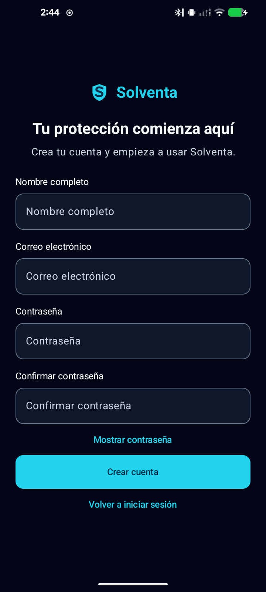
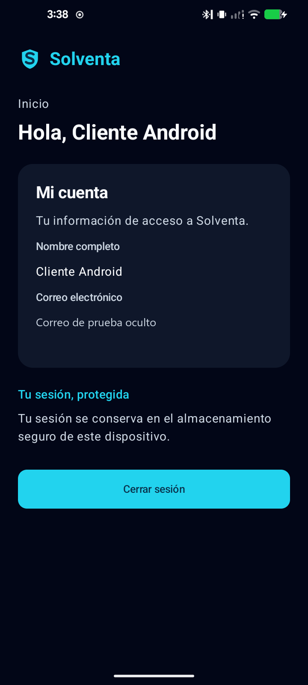

# Registro, acceso y cuenta móvil

Historia: [SOL-332](https://proyectointegradorgrupo2.atlassian.net/browse/SOL-332).

## Alcance

- Crear cuenta con nombre, correo, contraseña y confirmación.
- Confirmar el registro sin abrir una sesión implícita y preparar el correo para ingresar.
- Mostrar Inicio/Mi cuenta con nombre y correo del usuario autorizado.
- Conservar recuperación de sesión, renovación de tokens y cierre seguro.

El acceso convencional no incluye edición de perfil, recuperación de contraseña,
pólizas o pagos. La variante aislada añade la revisión local de fotos descrita abajo.
SOL-169 añade el acceso con clave protegida por biometría descrito abajo; la historia
completa sigue pendiente de validación de onboarding/selfie y prueba de vida
con el servicio. SOL-189 queda fuera.

### Referencia provisional de términos y privacidad

«Crear cuenta» abre primero el formulario `REGISTER`. Nombre, correo, contraseña
y confirmación deben superar la validación antes de `REGISTER_REFERENCE`.
Esta segunda pantalla reutiliza el orden de la app original y la referencia
visual aportada por el usuario: barra superior con regreso al formulario,
dos filas de casilla y «Continuar» deshabilitado hasta seleccionar términos.
Open Finance es opcional, como en `AuthScreens.kt:340-358` de la app original.
Las filas completas son controles de casilla; ninguna selección aparece marcada
de entrada. Volver conserva los cuatro campos solo en RAM y volver a continuar
presenta las casillas sin marcar.

La nota indica que los textos son de referencia: las selecciones no registran
consentimiento legal ni autorizan acceso financiero. No se envían al backend
ni se agregan campos al contrato de alta. `continueRegistration(termsSelected)`
requiere formulario válido y selección local de términos; la variante aislada
abre las fotos y la normal envía el alta una sola vez. Salir, detener la actividad
o recrearla descarta el borrador. Las contraseñas y casillas no usan estado guardado.

El coordinador contrastó la app original `solventa-app@6a3521af`: sus casillas
de términos carecen de texto legal, versión o contrato. El contenido académico
web/i18n tampoco acredita un documento aprobado. Las rutas candidatas
`juanes545.github.io/solventa-web/legal/terms` y `/legal/privacy` devolvieron
404 en esa revisión. No se añadieron enlaces rotos ni términos de una empresa
homónima. El usuario autorizó mostrar referencias mientras se depura el texto.
Quedan pendientes contenido legal propio aprobado, publicación y contrato
de consentimiento antes de afirmar aceptación o cumplimiento legal.

### SOL-169: consulta de disponibilidad, iteración 1

Desde el login, «Consultar biometría» consulta AndroidX Biometric 1.1.0
con `BIOMETRIC_WEAK` (capacidad de biometría de clase 2 o superior, sin PIN como
sustituto). La biblioteca adapta la consulta desde API 26, el mínimo de la app.
La consulta distingue dispositivo disponible, sin enrolamiento, sin hardware,
sensor temporalmente no disponible, actualización de seguridad necesaria,
consulta no soportada y estado desconocido.
En API 26 a 28 AndroidX consulta huellas compatibles; desde API 29 consulta el
gestor biométrico del sistema. Por eso un resultado negativo no afirma que el
dispositivo carezca de otras modalidades que esta consulta no puede detectar.
AndroidX aporta `USE_BIOMETRIC` y `USE_FINGERPRINT` al manifiesto combinado;
son permisos normales, sin solicitud de permiso en tiempo de ejecución.
no se añade permiso de cámara para esta consulta.

Un diálogo nativo muestra el resultado y aclara que el servicio no está habilitado
en las variantes normales ni existe verificación con selfie. La variante aislada
explica el alcance de la clave protegida por biometría. «Usar contraseña»
cierra el diálogo y enfoca el correo del formulario existente.
Cada apertura consulta de nuevo el dispositivo; no conserva capacidad ni
credenciales entre recreaciones. Durante un login en curso no abre la consulta.

Este flujo no abre `BiometricPrompt`, no verifica identidad, no llama al backend,
no guarda tokens y no crea una sesión. No captura ni registra datos biométricos.
Esta consulta informativa conserva su función aunque la variante aislada habilite
el flujo de firma siguiente.

`BiometricAccessInfoTest` cubre los códigos de capacidad; `AccessScreensTest`
comprueba mensajes, semántica de título, texto ampliado, alternativa y ausencia
de sesión al consultar, además del login convencional. `AppLaunchTest` y
`LoginLayoutTest` conservan los casos instrumentados de acceso y legibilidad.
El recorrido JVM de consulta y vuelta al login usa Robolectric en API 26, 28, 29 y 35.
Estas pruebas no sustituyen una comprobación en hardware ni de lector de pantalla.

### SOL-169: acceso con clave protegida por biometría

La variante `biometricTest` habilita el flujo contra el backend local autorizado.
Las variantes normales conservan `BIOMETRIC_LOGIN_ENABLED=false` e issuer vacío:
no se ha confirmado un issuer de producción y no se deriva de la URL del BFF.
El usuario conserva el acceso convencional.

Después de ingresar con contraseña, «Habilitar acceso biométrico» pide consentimiento
y la contraseña actual, transitoria. Android genera una clave EC P-256 no exportable
en AndroidKeyStore. Cada firma exige `BIOMETRIC_STRONG` mediante `CryptoObject`
y `SHA256withECDSA`; PIN y credenciales del dispositivo no autorizan esta operación.
Android invalida la clave al cambiar las biometrías enroladas. Cualquier biometría
compatible registrada en ese teléfono puede autorizarla; Android no identifica
qué persona o huella intervino.

El servidor entrega un desafío de 60 segundos. El cliente valida propósito, issuer
exacto, usuario, credencial, clave, expiración y las nueve líneas del mensaje.
Solo el límite de futuro del cliente admite cinco segundos de desfase del reloj;
conserva la expiración original y rechaza una fecha igual o anterior al momento actual.
El servidor mantiene sus 60 segundos y rechaza pruebas vencidas o repetidas.
Firma los bytes recibidos, decodificados de base64url sin padding; envía firma ASN.1
DER y pública SPKI/X.509 DER. El servidor debe validar la prueba antes de devolver
la sesión convencional. No hay sesión por un callback local ni contraseña persistida.
No se usa atestación remota ni se afirma hardware certificado, identidad civil o KYC.
Un rostro fuerte del sistema, si existe, tampoco equivale a selfie o prueba de vida.

La instalación conserva un solo vínculo local. Cerrar sesión mantiene esa clave,
pero limpia listas y mensajes de administración de la cuenta anterior. Otra cuenta
no puede usar ese vínculo como propio ni borrar su clave mediante una revocación
ajena. Una respuesta biométrica tardía no puede deshacer un logout o sustituir otra
cuenta; renovar tokens del mismo actor conserva el contexto.

«Desactivar credencial» revoca primero en el servidor y después elimina la clave
y el vínculo locales. Un fallo se muestra y permite reintentar; no se anuncia
revocación completa si falla la limpieza. La revocación afecta pruebas y familias
de refresh ligadas, sin prometer invalidación instantánea de JWT de acceso ya emitidos.
Cancelación, bloqueo del sensor, clave invalidada o restauración sin clave requieren
el acceso convencional. Desde la cuenta autorizada se puede revocar el vínculo y
habilitar otro. No se capturan selfies, plantillas ni datos biométricos.

| Operación biométrica local | Endpoint bajo `/movil/v1` |
| --- | --- |
| Desafío de alta, bearer y contraseña actual | `POST /biometria/enrolamientos/desafio` |
| Confirmación de alta mediante firma | `POST /biometria/enrolamientos` |
| Desafío de acceso, sin bearer | `POST /biometria/desafios` |
| Prueba firmada y sesión, sin bearer | `POST /sesiones/biometria` |
| Credenciales propias | `GET /biometria/credenciales` |
| Revocación de credencial propia | `DELETE /biometria/credenciales/{id}` |

La implementación local de SOL-314 permite probar este contrato; no implica publicación
ni aceptación completa de HU17. Se comprobó el recorrido con huella aportada por el
usuario en un teléfono físico, contra el stack local y una cuenta sintética: alta,
login, cancelación, revocación y vuelta al acceso convencional. La app aislada quedó
instalada y sin sesión; la habitual no se reemplazó.
Ver [pruebas y límites](testing.md#biometría-sol-169), incluida la diferencia entre
la interoperabilidad JVM y la prueba física.

### Diseño compartido y tema del dispositivo

`SolventaTheme` define colores semánticos claros/oscuros, tipografía y formas;
`SolventaPage` comparte márgenes de 20 dp, separación de 16 dp, ancho máximo
de 560 dp, desplazamiento e insets de sistema/teclado. Login, registro,
confirmación, cuenta, huella y recorrido local usan esta base. El tema sigue
`isSystemInDarkTheme()`; no fija el modo del teléfono. Las barras edge-to-edge
y el fondo de arranque tienen variantes claras/oscuras.

La cabecera y las acciones se centran; campos, valores y errores conservan
alineación al inicio. El login tiene una sola acción principal, «Ingresar»;
crear cuenta y consultar disponibilidad son acciones de texto.
La consulta no aparenta iniciar sesión. La recuperación sin implementación no
se muestra. El contenedor puede separar cabecera, contenido y acciones: aprovecha
la altura disponible y desplaza el conjunto cuando no cabe, sin fijar un pie
sobre los campos ni añadir un segundo inset de teclado.

Los campos siguen siendo `OutlinedTextField` de Material 3, como en
`feature/auth/AuthScreens.kt:182-217` de
`JUANES545/solventa-app@6a3521afc2cd865c6579a77e2974fce353ac02e1`
(blob `571e3a4431cafa4178a88c03ba07b0eb58ce091c`).
El correo muestra `nombre@ejemplo.com` cuando está vacío. Login, contraseña
de registro y confirmación tienen un botón de ojo a la derecha, con nombre
accesible de mostrar/ocultar; los dos ojos de registro actúan por separado.
El formulario oculta las contraseñas antes de pasar a términos. No añade una
biblioteca de iconos ni cambia la política de teclado, sesión o huella.
Términos usa `Scaffold`/`TopAppBar` nativos, como `SolventaScreen` original,
con fondo del tema, título al inicio y botón redondeado.

El launcher reutiliza el escudo y la S de la marca en un icono adaptativo.
AndroidX Core SplashScreen 1.0.1 muestra ese recurso con la paleta del sistema y
retira el splash mediante un fundido de 180 ms; con animaciones deshabilitadas
lo retira inmediatamente. No espera red ni autenticación. En API 26 la barra
de navegación de arranque es negra para conservar el contraste de sus iconos
claros; desde API 27 sigue la paleta del sistema con iconos claros/oscuros.
La actividad solicita orientación vertical, sin bloqueos runtime adicionales.
Multiwindow, fabricantes y pantallas grandes pueden no respetar esa solicitud;
Android 16 con target 36 o superior ignora restricciones en pantallas >= 600 dp.

La referencia es el archivo Figma `nJOUczPWhuJJT8rSKlw69o`: paletas `5:107`
y `5:150`, acceso `2031:11`, registro `2090:3` y KYC `2033:26`.
Se consultaron contexto de diseño y capturas de esos frames. La adaptación
conserva los campos y contratos reales: no copia la simulación del prototipo,
campos sin contrato, estados de identidad verificada ni consentimientos ficticios.
La comprobación automatizada de layout no acredita fidelidad visual píxel a píxel.

Las fuentes locales Geologica y Afacad Flux proceden de
`JUANES545/solventa-app@6a3521afc2cd865c6579a77e2974fce353ac02e1`,
`app/src/main/res/font/geologica_variable.ttf` y
`app/src/main/res/font/afacad_flux_variable.ttf`. Los archivos conservan los blobs
originales `9e7771e32575873bba48b16b6ef1696b63087a2a` y
`a3df5d13a3bf86f5c2a115e441fed425f14e7ac2`; sus licencias OFL están en
`docs/licenses/OFL-Geologica.txt` y `docs/licenses/OFL-Afacad-Flux.txt`.
Compose aplica el eje de peso de cada fuente variable; no necesita descargarlas
durante el uso de la app.

### Documento y selfie locales en la variante aislada

Solo `biometricTest` habilita `PHOTO_REVIEW_ENABLED`. Tras la validación del
formulario y las casillas de referencia provisional,
la app conserva nombre, correo y contraseña en un borrador de RAM y abre
`REGISTER_PHOTOS`: documento → selfie → resumen local. Todavía no envía el alta.
Después de revisar y eliminar ambas fotos, «Continuar» cierra el diálogo y abre
`REGISTER_CONFIRM`. El usuario pulsa «Crear cuenta» para enviar un único
`POST /movil/v1/usuarios`. Solo una respuesta confirmada abre `REGISTERED`,
sin sesión. «Iniciar sesión» vuelve al acceso con correo preparado y contraseña
vacía. Las variantes normales, sin cámara, envían el alta al continuar después
de las casillas, sin etapa de fotos.

El usuario concede CAMERA y abre explícitamente cada paso: documento usa cámara
trasera y selfie usa frontal. Si falta la cámara de ese paso se informa el error,
sin cambiar silenciosamente a la otra lente. El documento conserva disparador manual; la selfie
usa la guía y autocaptura descritas abajo. Cada paso requiere JPEG válido y
aceptación explícita.

El documento muestra un marco rectangular decorativo, no una detección.
El área de imagen se obtiene con las mismas transformaciones públicas CameraX
que usa selfie: metadatos de recorte → vista, excluyendo barras de ajuste.
El marco se limita a la intersección visible, con contorno doble de la paleta,
sin verde de validación. Mientras no hay geometría válida no se dibuja ni se
habilita el disparador. El usuario pulsa «Tomar foto»; no hay OCR, extracción
de texto, reconocimiento del documento ni SDK de escáner adicional.
El analizador de este paso solo consulta metadatos de CameraX y cierra cada
`ImageProxy`; no accede a sus píxeles ni ejecuta ML Kit.

La ventana de fotos solicita tamaño `MATCH_PARENT` y mide contra los límites
reales de Android, no contra la altura de pantalla de la configuración.
Esto evita que el pie quede fuera de una ventana reducida por insets mientras
el scroll considera que cabe. Se mantienen controles de al menos 52 dp,
insets del contenedor y desplazamiento completo cuando el contenido no cabe.
La app revalida el archivo, presenta una transición fija de 600 ms y elimina
el temporal antes de mostrar «recibido en este dispositivo». El resumen requiere
ambos pasos. Volver a capturar el documento invalida los dos avances. Un error
de limpieza no confirma la recepción ni permite finalizar.

Cancelar o descartar el diálogo vuelve al formulario y elimina el borrador,
sin crear una cuenta. Reintentar fotos no envía el registro. Rotación, fondo y
cambio de actor/contexto descartan archivos, avances y el borrador de alta.
Un proceso nuevo no restaura fotos, contraseñas o estados de recepción ni
reenvía el registro. Un fallo al borrar archivos impide llegar a la confirmación.

Login y Mi cuenta ya no ofrecen una entrada suelta a las fotos. El recorrido
local no crea sesiones, grants, claves o estados KYC, ni sustituye la
autorización biométrica. La confirmación de fotos solo permite continuar
el formulario; no acredita una validación del servicio.

El enunciado (p. 9) contempla selfie/PAD, biometría y digitalización de soportes,
sin exigir explícitamente documento de identidad durante el registro. Figma
`2033:26` y la app original incluyen documento. Esta adaptación local respeta
la separación de alta/acceso de SOL-332/SOL-333 y deja pendientes los criterios
de PAD/identidad segura de SOL-169. La arquitectura v7 (pp. 2–4, 10 y 12)
exige privacidad y separación por canal: aquí no se agrega un contrato BFF,
reglas de negocio o consentimiento persistido. Las fotos no se envían al servidor.

CameraX 1.4.2 (`core`, `camera2`, `lifecycle`, `view`) se incorpora solo en
`biometricTest`. No se abre una app de cámara externa, galería ni FileProvider.
La cámara escribe JPEG en `cacheDir/photo-review`, con nombres aleatorios sin
identificadores de cuenta. La validación comprueba que el archivo existe, tiene
contenido JPEG decodificable, hasta 20 MiB y 64 millones de píxeles. La vista usa
una copia muestreada de hasta 1024 píxeles de lado y orientación EXIF.
La validación del JPEG no comprueba rostro, presencia viva ni titularidad.

La app no envía imágenes ni las guarda en preferencias, authstore, MediaStore o
copias de seguridad. El diálogo impide capturas del sistema mediante `SecureOn`.
Limpia el archivo y la vista al aceptar cada paso, repetir, cancelar, fallar, salir al fondo
o cambiar de contexto de acceso/cuenta. Una recreación interrumpe el recorrido;
un proceso nuevo limpia archivos huérfanos y no restaura la foto ni un resultado.
Los callbacks tardíos se descartan por generación y eliminan su archivo propio.
Los fallos de almacenamiento se notifican; nunca producen una finalización exitosa.

`debug`, `release` y `preview` conservan el flag apagado y un host vacío: no incluyen
el motor de foto, dependencias CameraX/ML Kit, permiso CAMERA ni proveedor POC.
No cambian URL, issuer, registro/login, contrato de huella ni flags productivos.
La foto/revisión durante el borrador sin sesión no genera llamadas HTTP: restaurar un
almacén vacío también es local. Una sesión real conserva su revalidación al
reanudar la actividad, incluso con la foto abierta. Si el servicio invalida
la sesión, la UI retira la cuenta y descarta su recorrido/foto. El login y la
huella reales siguen necesitando su backend habitual cuando el usuario decide usarlos.

### Guía local y autocaptura de selfie

Solo la cámara de selfie añade ML Kit Face Detection 16.1.7 con el modelo
incluido en el APK. CameraX comparte el mismo viewport entre vista, análisis
y captura. El resultado de ML Kit ya tiene aplicada la rotación: se transforma
con `ImageProxyTransformFactory` y `CoordinateTransform` hasta el contenido
visible y su óvalo, considerando recorte, espejo y barras de ajuste.
No se comparan coordenadas de la imagen con píxeles de pantalla sin transformar.

La guía exige exactamente un rostro, resolución facial de al menos 100 x 100
píxeles, centro entre 0.4 y 0.6 del óvalo en cada eje, ancho entre 0.62 y 0.96,
alto entre 0.62 y 0.98, pitch/yaw de hasta 12 grados y roll de hasta 10 grados.
Además, la caja facial debe quedar dentro de los límites rectangulares
normalizados del óvalo: centro y tamaño válidos por separado no bastan.
Si desborda por posición se pide centrar; si excede el tamaño, alejarse.
Esto no exige que las cuatro esquinas estén dentro de la elipse ni valida
un contorno, identidad o prueba de vida.
Debe mantener esas condiciones durante 900 ms, con intervalos y antigüedad
de resultados de hasta 300 ms. Movimiento, pérdida de rostro, múltiples rostros,
resultados obsoletos, pausa o cambio de intento reinician la estabilidad.
Son constantes preliminares de encuadre; necesitan calibración con el SDK real
en el teléfono, no son umbrales certificados de calidad o prueba de vida.

La app usa detección FAST sin contornos, landmarks, clasificación ni seguimiento.
No pide sonreír o parpadear; no reconoce personas, no compara contra el documento,
no valida identidad y no implementa PAD. Un guard atómico permite un solo disparo
por intento, únicamente con permiso, cámara explícitamente abierta, vista completa
y primer plano. El usuario mantiene revisión, aceptación, repetición y salida.
Una foto nunca se acepta ni se sube automáticamente.

El análisis mantiene solo el último fotograma. Al terminar se cierran
`ImageProxy`, detector y executor; si hay una tarea pendiente, sus recursos
se liberan al recibir el callback y se descarta ese resultado. Una tarea que
no responde en cinco segundos presenta error y permite salir o reintentar,
sin capturar ni anunciar éxito. La app no persiste ni registra los fotogramas
analizados, caras, ángulos, proporciones o identificadores de seguimiento.

Antes de abrir selfie se informa: «Tu selfie se analiza en este teléfono.
ML Kit no envía la imagen ni el resultado a Google, pero sí métricas técnicas
y de uso». «Cómo se usan los datos» explica dispositivo/app/versión,
identificador por instalación, rendimiento, formato y tamaño de entrada/salida,
eventos, errores y contactos por compatibilidad o actualizaciones.
No hay checkbox legal ficticio ni configuración inventada para desactivar
colección. El modelo incluido permite inferencia sin descargarlo; eso no
significa que el SDK carezca de telemetría o tráfico.

Fuentes: [guía Android](https://developers.google.com/ml-kit/vision/face-detection/android),
[conceptos](https://developers.google.com/ml-kit/vision/face-detection/face-detection-concepts),
[términos de ML Kit](https://developers.google.com/ml-kit/terms),
[declaración de datos Android](https://developers.google.com/ml-kit/android-data-disclosure)
y [transformaciones CameraX](https://developer.android.com/media/camera/camerax/transform-output).
El SDK se distribuye bajo los términos de ML Kit, no bajo las licencias OFL
de las fuentes. La evidencia física histórica de las dos fotos manuales no
acredita esta autocaptura nueva; ver [pruebas y límites](testing.md).

## Integración

Se reutiliza el BFF móvil desplegado en AWS, no el BFF web:

| Operación | Endpoint |
| --- | --- |
| Registro | `POST /movil/v1/usuarios` |
| Login | `POST /movil/v1/sesiones` |
| Sesión actual | `GET /movil/v1/sesiones/actual` |
| Renovación | `POST /movil/v1/sesiones/renovar` |
| Cierre | `DELETE /movil/v1/sesiones/actual` |

El registro solo devuelve un usuario. No almacena tokens ni inicia sesión automáticamente.
Después de un registro válido, se descarta cualquier identidad anterior almacenada localmente.
El usuario inicia sesión explícitamente; la sesión se conserva cifrada mediante Android Keystore.

Se mantienen la serialización de renovaciones y el reemplazo conjunto de tokens rotados.
La recuperación comprueba la sesión al reanudar la aplicación. Un rechazo definitivo retira
el acceso; una sesión vencida se diferencia de credenciales incorrectas.

## Validaciones y errores

- Nombre de 1 a 120 caracteres y contraseña de 8 a 128, contando caracteres Unicode como el backend.
- Correo obligatorio y válido; la contraseña no se recorta ni normaliza.
- La confirmación solo se valida en el cliente: no se envía al BFF.
- Solicitud inválida, correo existente, credenciales incorrectas, límite de intentos y red
  tienen resultados recuperables. Un registro de resultado incierto no se anuncia como creado.
- Durante el envío se bloquean acciones repetidas y navegación atrás del formulario.
- Contraseñas transitorias en memoria: no se guardan mediante estado restaurable ni en disco.

## Comprobación histórica en dispositivo físico de SOL-332

Samsung A21s, por USB. Actualización de APK con firma compatible, sin desinstalar ni borrar datos.
La permanencia de pantalla por USB se habilitó con autorización y se restauró al terminar.

| Comprobación | Resultado |
| --- | --- |
| Registro real y confirmación sin sesión automática | Correcto |
| Correo preparado y contraseña vacía al volver al login | Correcto |
| Login y datos reales en Mi cuenta | Correcto |
| Recuperación tras cerrar el proceso y abrir la aplicación | Correcto |
| Cierre y retirada de información protegida | Correcto |
| Correo duplicado rechazado, sin sobrescribir la cuenta | Correcto |
| Batería instrumentada completa | 15 pruebas correctas |
| Pruebas JVM | 20 pruebas correctas |
| Scripts de automatización existentes | 136 pruebas correctas |

El recorrido real utiliza una cuenta aislada con credenciales generadas en memoria y deja
su sesión cerrada. No se publican credenciales o tokens en el repositorio, informes o capturas.
El correo se oculta en la evidencia de Mi cuenta. Los casos instrumentados de error usan
servicios en memoria, sin provocar fallos ni modificar configuración del backend real.

| Pantalla | Evidencia en dispositivo físico |
| --- | --- |
| Crear cuenta |  |
| Inicio/Mi cuenta |  |
